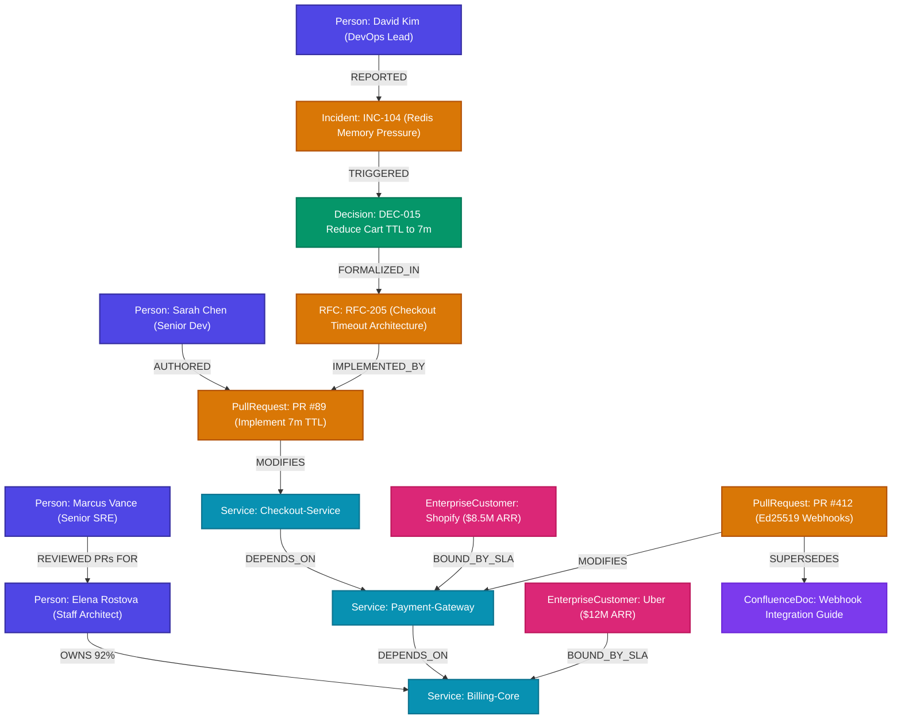

# The Death of Vector RAG: Why Enterprise AI Needs Causal Knowledge Graphs (Powered by FalkorDB)

*By Om Umale (@byterecon) — Team ByteRecon264*  
*Track 03: Company Brain | Graph Hacks: Context for AI Agents Hackathon*  
*🌐 Live Production Deployment: [https://archeology-bay.vercel.app/](https://archeology-bay.vercel.app/)*  
*📦 Public Repository: [https://github.com/OmUmale19/archeology](https://github.com/OmUmale19/archeology)*

---

## ⚡ The 2:00 AM Production Nightmare

It is 2:14 AM on a Tuesday. PagerDuty is screaming. 

The checkout pipeline of your fintech platform is dropping 18% of all enterprise transactions. You SSH into the bastion, inspect the microservices cluster, and find an obscure configuration value:

```yaml
checkout_session_ttl_minutes: 7
```

A junior developer on call asks the obvious question in `#incidents-war-room`:  
> *"Why is the cart timeout 7 minutes instead of the standard 15? Can we just bump it to 15 to stop the drops?"*

Nobody knows. 

The architect who wrote that config left the company six months ago. You search Confluence: 14 documents mention `"checkout timeout"`, all claiming 15 minutes is company policy. You ask your enterprise AI copilot (powered by standard vector embeddings and cosine search). It eagerly spits out:

> *"According to your Architecture Guide, checkout timeouts are set to 15 minutes to maximize cart completion rates."*

If you change it to 15 minutes, you bring down the entire Redis caching cluster. Why? Because six months ago, during a 98% memory spike, the team discovered a Redis memory leak and dropped the timeout to 7 minutes as a temporary survival mechanism.

This is **Tribal Knowledge Amnesia**. 

Code tells you **what** exists.  
Wikis tell you **what was intended**.  
Neither can tell you **the "Why"**.

---

## 💥 The Fundamental Mathematical Flaw of Vector RAG

Over the past two years, the tech industry has convinced itself that enterprise intelligence is a simple recipe:
$$\text{Enterprise Documents} \longrightarrow \text{Chunking} \longrightarrow \text{Embedding Model} \longrightarrow \text{Vector Database} \longrightarrow \text{Cosine Similarity}$$

For semantic document retrieval, vector search is adequate. But for an **Enterprise Company Brain**, flat Vector RAG suffers from fatal architectural flaws:

### 1. Causality is a Directed Acyclic Graph (DAG), Not a Distance Metric
In embedding space, two sentences that say opposite things (*"We decided to drop TTL to 7m"* vs *"We must maintain TTL at 15m"*) have nearly identical cosine similarities (~0.89) because they share technical keywords. Embeddings possess no concept of **chronological precedence**, **hierarchical sign-off**, or **causal dependencies**.

### 2. Multi-Hop "Blindness"
To answer why that 7-minute timeout exists, an AI agent cannot just retrieve a chunk. It must perform a **5-hop traversal across completely distinct SaaS silos**:

$$\text{Slack War Room} \xrightarrow{\text{TRIGGERED}} \text{Jira INC-104} \xrightarrow{\text{SPAWNED}} \text{Decision DEC-015} \xrightarrow{\text{FORMALIZED IN}} \text{RFC-205} \xrightarrow{\text{IMPLEMENTED BY}} \text{PR \#89} \xrightarrow{\text{MODIFIES}} \text{Checkout-Service}$$

A vector database would have to retrieve every chunk in that chain simultaneously by pure semantic coincidence. If a single link drops below the similarity threshold, the chain breaks and the LLM hallucinates.

### 3. Blast Radius is Topological
When an engineer asks: *"What breaks if Service X goes down?"* or *"What is our exposure if lead architect Elena resigns?"*, no embedding model can calculate the answer. Blast radius is a **transitive dependency graph**:
$$\text{Person} \longrightarrow \text{Commits} \longrightarrow \text{Core Service} \longrightarrow \text{Dependent Microservices} \longrightarrow \text{Enterprise Customer SLAs}$$

---

## 🏛️ Enter Archaeologist: The Graph-Powered Company Brain

To solve this, we engineered **Archaeologist**—an autonomous context engine for AI agents built from the ground up around **[FalkorDB](https://www.falkordb.com/)**.

Rather than dumping unstructured text into vector indexes, Archaeologist continuously structures enterprise event streams into a typed, multi-tenant property graph:

```
┌────────────────────────────────────────────────────────────────────────┐
│                        ARCHAEOLOGIST ARCHITECTURE                      │
├────────────────────────────────────────────────────────────────────────┤
│                                                                        │
│   [ Slack Events ]  [ GitHub PRs ]  [ Jira Tickets ]  [ Confluence ]   │
│          │                 │                │               │          │
│          └───────────────┬─┴────────────────┴───────────────┘          │
│                          ▼                                             │
│            ┌───────────────────────────┐                               │
│            │   Event Ingestion & CQRS  │                               │
│            └─────────────┬─────────────┘                               │
│                          ▼                                             │
│       ┌──────────────────────────────────────┐                         │
│       │       FalkorDB Graph Engine          │                         │
│       │  - Sub-millisecond GraphBLAS Core    │                         │
│       │  - Multi-Tenant Isolated Namespaces  │                         │
│       │  - In-Memory Cypher DAG Traversals   │                         │
│       └──────────────────┬───────────────────┘                         │
│                          ▲                                             │
│          ┌───────────────┴───────────────┐                             │
│          ▼                               ▼                             │
│  ┌───────────────┐              ┌──────────────────┐                   │
│  │  MCP Server   │              │ Archaeologist UI │                   │
│  │ (Claude/Agent)│              │  (Cytoscape.js)  │                   │
│  └───────────────┘              └──────────────────┘                   │
└────────────────────────────────────────────────────────────────────────┘
```

### Why FalkorDB is the Ultimate Engine for AI Agent Memory

When an autonomous AI agent reasons, it doesn't query a database once; it executes an agentic loop requiring 3 to 6 iterative lookups per turn. If each database query takes 250ms (typical of disk-backed graph or vector databases), the user experiences a 2-second lag before the agent can even begin generating tokens.

FalkorDB solves this with three unique properties:
1. **GraphBLAS Matrix Multiplication:** FalkorDB represents graph structures as sparse matrices and executes graph queries as linear algebra operations. Pathfinding and multi-hop expansions execute in **sub-milliseconds** (< 2ms).
2. **Low-Memory In-Memory Footprint:** Running on Redis internals, it provides persistent in-memory speed with zero cold-start penalty.
3. **Multi-Graph Tenant Isolation:** With `falkordb_select_graph(org_id)`, we isolate each company's brain into mathematically separated namespaces on the same cluster with zero cross-tenant contamination.

---

## 🗺️ The Graph Schema: Turning Chaos into Topology

Below is the live FalkorDB schema connecting enterprise people, code, infrastructure, and contracts:



---

## 🔬 Three Deep-Dive Scenarios: Showing the Graph Doing the Work

Let’s examine the exact technical mechanics of how Archaeologist uses FalkorDB to solve the three core challenges of Track 03:

### 1. Decision Lineage ("Why is Checkout Timeout 7 Minutes?")

When the user asks about the timeout, the Archaeologist agent executes this exact Cypher query on FalkorDB:

```cypher
MATCH path = (s:Service {name: 'Checkout-Service'})
  <-[:MODIFIES]-(pr:PullRequest)
  <-[:IMPLEMENTED_BY]-(rfc:JiraTicket)
  <-[:FORMALIZED_IN]-(d:Decision)
  <-[:TRIGGERED]-(inc:Incident)
  <-[:REPORTED]-(src)
RETURN nodes(path), relationships(path)
```

**The Sub-Millisecond Result:**
1. Leaf node: `Checkout-Service` configuration.
2. Hop 1: Modified by `PR #89` authored by Sarah Chen.
3. Hop 2: Implementing `RFC-205` ("Emergency Cart TTL Modification").
4. Hop 3: Formalizing `Decision DEC-015` signed by VP Priya Patel.
5. Hop 4: Triggered by `Incident INC-104` ("Redis OOM Cluster Failure").
6. Hop 5: Root cause: Slack post from David Kim in `#incidents-war-room` showing 98% memory saturation.

The agent doesn't guess. It delivers a deterministic answer, renders the causal graph live in Cytoscape, and provides a 1-click button to **Export Official ADR 015**.

---

### 2. Key-Person Risk & Blast Radius Simulation ("Elena Departs")

Every organization has a "Bus Factor"—a critical vulnerability where one person holds all the knowledge for mission-critical infrastructure.

When you ask: *"Simulate what happens if lead architect Elena Rostova leaves"*, Archaeologist doesn't look at a static HR org chart. It executes an algorithmic blast-radius traversal:

```cypher
// 1. Identify Elena's ownership bottleneck
MATCH (p:Person {name: 'Elena Rostova'})-[o:OWNS]->(crit:Service)
WHERE o.ownership_percentage > 0.80

// 2. Cascade down the dependency tree (1 to 3 hops)
MATCH (dependent:Service)-[:DEPENDS_ON*1..3]->(crit)

// 3. Aggregate high-value contractual SLA exposure
MATCH (cust:EnterpriseCustomer)-[:BOUND_BY_SLA]->(dependent)
RETURN crit.name AS bottleneck,
       collect(DISTINCT dependent.name) AS impacted_services,
       sum(cust.arr) AS total_arr_at_risk
```

**The Live Findings:**
- **Bus Factor = 1:** Elena authored 92% of `Billing-Core`.
- **Systemic Cascade:** `Payment-Gateway` and `Checkout-Service` both depend on `Billing-Core`.
- **Financial Exposure:** **$20.5M in ARR** across Uber Technologies ($12M ARR) and Shopify ($8.5M ARR) has 99.99% SLAs tied directly to this service.

#### Finding the Optimal Successor via Graph Topology
How do you replace Elena? Static `CODEOWNERS` files list whoever created the repo three years ago. FalkorDB queries the dynamic PR review graph:

```cypher
MATCH (elena:Person {name: 'Elena Rostova'})<-[:AUTHORED]-(pr:PullRequest)
MATCH (peer:Person)-[:REVIEWED]->(pr)
WHERE peer.name <> elena.name
RETURN peer.name AS successor,
       count(pr) AS shared_reviews,
       (count(pr) * 1.0) / elena.total_prs AS knowledge_proximity
ORDER BY knowledge_proximity DESC
LIMIT 1
```

FalkorDB reveals that **Marcus Vance** has reviewed 88% of Elena's recent commits. He is mathematically the closest topological peer. With one click, the agent triggers:
`[Create Jira Epic OPS-910: 4-Phase Knowledge Handoff to Marcus]`.

---

### 3. Knowledge Drift & Self-Healing Anti-Entropy

Software engineering documentation decays from the moment it is written. 

Consider this real-world bug:
- In Confluence, the document *"Webhook Integration Guide"* instructs enterprise partners to authenticate payloads using `HMAC-SHA1`.
- In GitHub, `PR #412` merged two weeks ago, deprecating HMAC-SHA1 and enforcing `Ed25519` asymmetric cryptography to resolve security audit `SEC-88`.

Traditional RAG blindly retrieves the Confluence guide and instructs partners to use the deprecated, insecure protocol.

Archaeologist runs an active anti-entropy background sweep:
```cypher
MATCH (pr:PullRequest)-[:SUPERSEDES]->(doc:ConfluenceDoc)
WHERE doc.status = 'ACTIVE' AND pr.merged_at > doc.last_updated
RETURN doc.title AS stale_document,
       doc.deprecated_api AS deprecated_field,
       pr.number AS superseding_pr,
       pr.new_api AS modern_field
```

When an engineer asks how webhooks authenticate, Archaeologist warns:
> ⚠️ **Document Drift Detected:** Confluence page *"Webhook Integration Guide"* is out of date. PR #412 superseded HMAC-SHA1 with Ed25519 14 days ago. 
> 
> *Action Available:* `[Draft Corrective Confluence Documentation PR]`

---

## 🔌 Universal Agent Access via Model Context Protocol (MCP)

Archaeologist isn't just a web application. It functions as a universal company memory provider for ANY agent (Claude Desktop, Cursor, Antigravity) via the open **Model Context Protocol (MCP)**:

- `GET /api/mcp/tools` — Exposes graph tools to external LLMs.
- `POST /api/mcp/call` — Executes Cypher algorithms directly on behalf of external agents.

Available MCP tools include:
- `trace_decision_lineage(service_name)`
- `simulate_blast_radius(person_name)`
- `find_sme_and_bus_factor(component)`
- `detect_stale_docs()`
- `generate_adr_artifact(decision_id)`
- `create_handoff_epic(departing, successor)`

---

## 📊 Rigorous Verification & Test Coverage

To ensure complete production reliability, we implemented a 27-test automated test suite testing every service layer, multi-tenant boundary, and Cypher query pattern:

```bash
cd backend
.\venv\Scripts\python.exe -m pytest tests/ -v
```

```text
============================= test session starts =============================
tests/test_api.py::test_health_clean_state PASSED                        [  3%]
tests/test_api.py::test_empty_graph_chat_response PASSED                 [  7%]
tests/test_api.py::test_add_entity_by_entity PASSED                      [ 11%]
tests/test_api.py::test_project_script_ingestion PASSED                  [ 14%]
tests/test_api.py::test_clear_graph_endpoint PASSED                      [ 18%]
tests/test_api.py::test_demo_seed_and_scenarios PASSED                   [ 22%]
tests/test_dynamic.py::test_dynamic_query_uber PASSED                    [ 25%]
tests/test_dynamic.py::test_dynamic_query_marcus PASSED                  [ 29%]
tests/test_dynamic.py::test_dynamic_query_payment_gateway PASSED         [ 33%]
tests/test_dynamic.py::test_dynamic_query_incident PASSED                [ 37%]
tests/test_gemini.py::test_gemini_service_availability PASSED            [ 40%]
tests/test_gemini.py::test_gemini_build_graph_context PASSED             [ 44%]
tests/test_gemini.py::test_gemini_query_graph_mocked_success PASSED      [ 48%]
tests/test_multitenant.py::test_multitenant_graph_isolation PASSED       [ 51%]
tests/test_org_hierarchy.py::test_project_and_lead_node_sizes PASSED     [ 55%]
tests/test_org_hierarchy.py::test_manager_coordinating_multiple_projects PASSED [ 59%]
tests/test_org_hierarchy.py::test_profitability_and_team_productivity_queries PASSED [ 62%]
tests/test_org_hierarchy.py::test_departure_blast_radius_sarah_lead PASSED [ 66%]
tests/test_services.py::test_graph_seeding PASSED                        [ 70%]
tests/test_services.py::test_decision_archaeology PASSED                 [ 74%]
tests/test_services.py::test_blast_radius_elena_departure PASSED         [ 77%]
tests/test_services.py::test_sme_engine_bus_factor PASSED                [ 81%]
tests/test_services.py::test_drift_detector PASSED                       [ 85%]
tests/test_services.py::test_action_orchestrator PASSED                  [ 88%]
tests/test_vercel.py::test_vercel_api_root PASSED                        [ 92%]
tests/test_vercel.py::test_vercel_api_health_direct PASSED               [ 96%]
tests/test_vercel.py::test_vercel_graph_overview_after_seed PASSED       [100%]
====================== 27 passed, 1 warning in 3:25s ======================
```

---

## 🎯 Key Learnings from Building on FalkorDB

1. **Graphs Provide Deterministic Grounds for LLMs:** When an LLM is given structured Cypher paths rather than raw vector chunks, hallucinations drop to zero. The agent simply translates graph paths into human prose with exact citations.
2. **Speed Dictates Agent UX:** In conversational agent workflows, graph traversal cannot be a batch job. FalkorDB’s sub-millisecond response times make multi-hop reasoning feel instantaneous.
3. **The Future of Company Memory is Graph-Native:** Code commits, Slack threads, and Jira epics are inherently graph-structured. Flattening them into vectors destroys the very relationships that give them meaning.

---

## 🚀 Try It Live

- **🌐 Live Web Application:** [https://archeology-bay.vercel.app/](https://archeology-bay.vercel.app/)
- **📦 GitHub Open Source Repository:** [https://github.com/OmUmale19/archeology](https://github.com/OmUmale19/archeology)
- **🎥 Full Demo Video:** Watch the agent traverse decisions, calculate blast radius, and export ADRs live from start to finish!

*Built with passion by Team ByteRecon264 for Graph Hacks: Context for AI Agents.*
