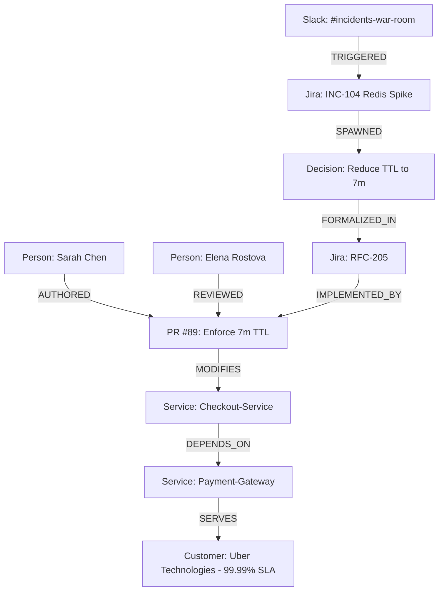

# Why Vector RAG Fails Enterprise Memory: Building an Autonomous Company Brain with FalkorDB & Causal Graphs

*By Om Umale (@byterecon) — Team ByteRecon264*  
*Submitted for Graph Hacks: Context for AI Agents (Track 03: Company Brain)*

---

## The Fatal Flaw of Enterprise Semantic Search

Every engineering organization with more than ten developers suffers from **Tribal Knowledge Amnesia**. 

Code in GitHub tells you *what* exists. Documents in Confluence tell you *what was intended*. But the **"Why"**—the production incident, the heated Slack debate at 2 AM, the architectural compromises, and the executive approvals—is scattered across ephemeral threads, closed tickets, and merged PR comments.

When organizations try to fix this with AI, they instinctively reach for **Vector RAG (Retrieval-Augmented Generation)**:
1. Dump Slack messages, Jira issues, and Notion pages into an embedding model.
2. Store vectors in a database.
3. Perform cosine similarity on user questions.

### Why Vector RAG Fails at the "Why":
Suppose an engineer asks:  
> *"Why is our checkout session timeout 7 minutes instead of 15?"*

Vector search finds every document that mentions *"timeout"* and *"checkout"*. But it cannot answer the question, because **causality is not a distance metric in embedding space—it is a Directed Acyclic Graph (DAG)**. 

To answer that question truthfully, an agent must traverse five hops across disparate domains:
$$\text{Slack War Room} \xrightarrow{\text{TRIGGERED}} \text{Jira INC-104} \xrightarrow{\text{SPAWNED}} \text{Decision RFC-205} \xrightarrow{\text{IMPLEMENTED BY}} \text{GitHub PR \#89} \xrightarrow{\text{MODIFIES}} \text{Checkout Config}$$

Flat similarity search is blind to graph topology. It cannot distinguish between a rejected proposal and an approved architectural mandate.

---

## Enter the Graph: Modeling FinFlow Inc. in FalkorDB

To solve this, we built **Archaeologist**, an autonomous AI agent context layer powered by **FalkorDB**. 

Instead of treating company records as disconnected text chunks, we model the entire organization as a typed, directional knowledge graph:



### Why FalkorDB?
FalkorDB's in-memory graph engine delivers **sub-millisecond graph traversals**. In an autonomous agent loop, where the LLM might execute 3 to 5 multi-hop tool queries per turn, database latency must be negligible (< 5ms). FalkorDB allows the agent to treat Cypher traversals as instantaneous memory lookups.

---

## Three Graph-Native Breakthroughs

### 1. Decision Archaeology & Deterministic Provenance
When the agent receives a "Why" query, it doesn't speculate or hallucinate. It executes a variable-length shortest-path Cypher query:

```cypher
MATCH path = (origin:SlackMessage)-[*1..5]->(target:Service {name: 'Checkout-Service'})
RETURN path
```

The agent extracts the exact sequence of historical events with direct links to the Slack permalink, the Jira incident, and the merged commit diff. Along with the natural language answer, the agent projects a compact Cytoscape subgraph that visually highlights the causal chain on the user's screen.

---

### 2. Algorithmic SMEs & Blast-Radius Simulation
Who actually owns a microservice?

Most enterprise tools look at static `CODEOWNERS` files or org charts. In reality, the engineer listed in `CODEOWNERS` may have switched teams nine months ago, while a junior engineer has reviewed the last 15 PRs.

Archaeologist computes dynamic Subject Matter Expertise using **FalkorDB PageRank & Betweenness Centrality** across the `(:Person)-[:REVIEWED|COMMITTED]->(:Service)` graph. 

Furthermore, when an executive asks:  
> *"What is our exposure if lead architect Elena leaves the company?"*

The agent traverses cross-domain dependencies:
- Elena is the **sole maintainer (92% code authorship)** of `Billing-Core` (Bus Factor = 1).
- `Payment-Gateway` and `Checkout-Service` depend synchronously on `Billing-Core`.
- Two Tier-1 Enterprise clients—**Uber Technologies ($12M ARR)** and **Shopify ($8.5M ARR)**—have 99.99% SLAs tied directly to this service.

The agent doesn't just sound an alarm—it uses shortest graph distance to identify that **Marcus Vance** reviewed Elena's recent pull requests (PR #72 and PR #99), identifying him as the mathematically optimal successor (knowledge proximity: 0.88).

---

### 3. Knowledge Drift & Self-Healing Invalidation
Documentation rot is an epidemic in tech companies. An architecture spec written in Confluence in 2023 tells developers to verify webhooks using `HMAC-SHA1`. Meanwhile, two weeks ago, a pull request merged `Ed25519` asymmetric signatures to resolve a security audit finding (`SEC-88`).

Archaeologist runs an anti-entropy pattern:
```cypher
MATCH (pr:PullRequest)-[:MODIFIES]->(s:Service)<-[:SPECIFIES]-(doc:Document)
WHERE pr.merged_at > doc.last_updated
MERGE (pr)-[:SUPERSEDES {detected_at: timestamp()}]->(doc)
```

When an engineer asks how webhooks work, the agent flags:
> ⚠️ **Document Stale:** Confluence page *Payment Gateway Webhook Guide* is superseded by PR #412. Ed25519 is now enforced.

---

## Closing the Loop: Moving from Chatbot to Action

A company brain that only talks is just an advisor. A true agent gets work done.

Archaeologist provides executable workflow buttons in the UI:
1. **1-Click ADR Generation:** Converts fragmented Slack debates and PR diffs into a standardized Markdown Architecture Decision Record (ADR 015) ready to commit into the repository.
2. **1-Click Jira Handoff Epic (OPS-910):** Automatically creates a four-phase knowledge transfer checklist (permissions delegation, runbook walkthrough, on-call shadowing) for the departing engineer and their designated successor.

---

## Conclusion

Enterprises don't lack data—they lack **connected context**. By placing FalkorDB at the center of the agent memory layer, we transform disconnected SaaS silos into an explainable, living graph that remembers across sessions, shows its causal work, and prevents costly architectural mistakes.

*Explore the open-source code and architecture on GitHub: [github.com/byterecon/archaeologist](https://github.com/byterecon/archaeologist)*
