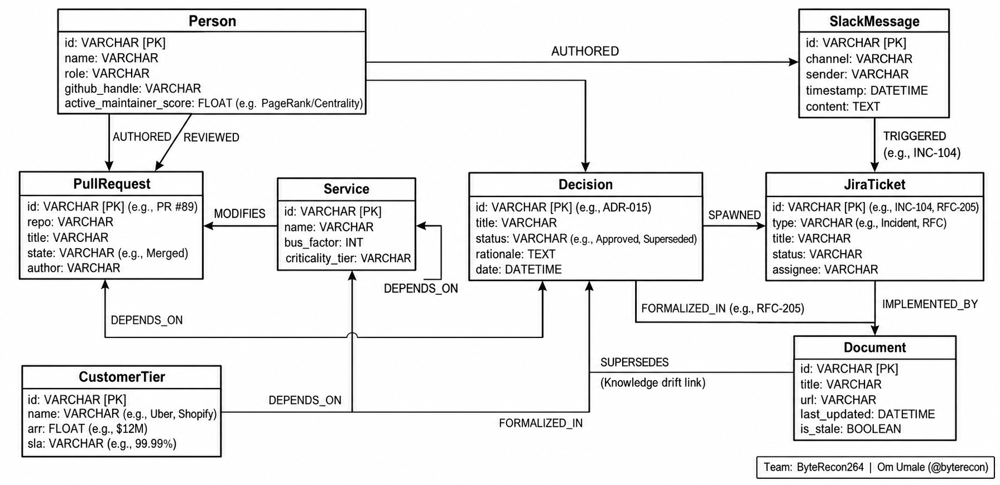
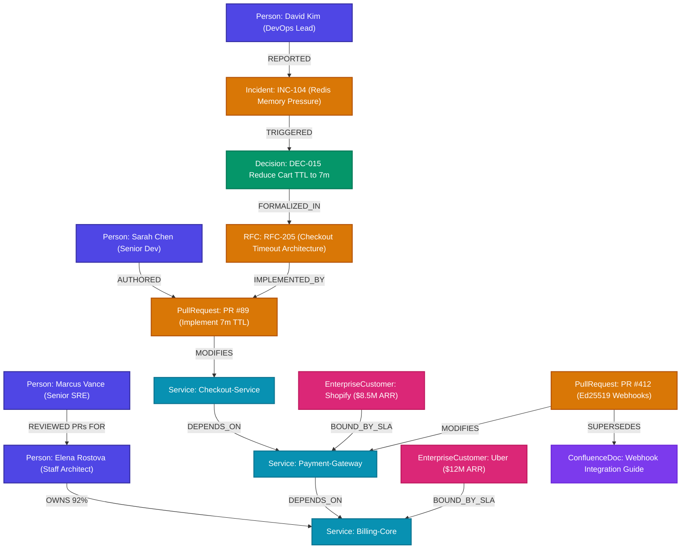

# 🧠 Archaeologist: The Enterprise Decision & Blast-Radius Brain
### Track 03: Company Brain | Powered by [FalkorDB](https://www.falkordb.com/)
*Graph Hacks: Context for AI Agents Hackathon*

---

## 📌 Executive Summary

Modern AI enterprise agents suffer from **Tribal Knowledge Amnesia**. Code repositories explain *what* exists, and wikis describe *what was intended*, but the **"Why"**—the architectural compromises, incident post-mortems, and critical tradeoffs—is scattered across ephemeral Slack debates, merged GitHub pull requests, and closed Jira tickets. When engineers leave, context vanishes.

Traditional **Vector RAG (Retrieval-Augmented Generation)** fails at enterprise memory because causality and blast radius are **topological properties (Directed Acyclic Graphs)**, not cosine-similarity distances.

**Archaeologist** is an autonomous AI agent context layer powered by **FalkorDB** that:
1. **Traces Multi-Hop Decision Lineage:** Follows directed causal paths from leaf configs/services back to PRs, Jira RFCs, and Slack discussions.
2. **Simulates Blast Radius & "Key-Person Risk" (Bus Factor):** Traverses cross-domain dependencies (`Code ➔ Services ➔ Humans ➔ Enterprise Customer SLAs`) to calculate systemic risk before engineers leave or code is refactored.
3. **Discovers Dynamic Subject Matter Experts (SMEs):** Uses FalkorDB graph algorithms (PageRank & Betweenness Centrality) to uncover real active maintainers instead of stale `CODEOWNERS`.
4. **Detects Knowledge Drift & Self-Heals:** Identifies documentation contradicted by recent code changes (`[:SUPERSEDES]`).
5. **Executes Real-World Engineering Workflows:** One-click generation of formal Architectural Decision Records (ADRs) and Jira Knowledge Transfer Epics.

---

## 🏛️ System Architecture & Design Patterns


### Applied System Design Patterns:
- **CQRS (Command Query Responsibility Segregation):** Ingestion path streams events and links causal edges transactionally; query path executes sub-millisecond Cypher traversals.
- **Hexagonal Architecture (Ports & Adapters):** Core domain logic is isolated from database drivers and LLM providers.
- **Model Context Protocol (MCP):** Standards-compliant MCP server exposing graph algorithms as tools to external agents (Claude Desktop, Cursor, Antigravity).
- **Subgraph Projection Pattern:** Converts high-dimensional Cypher traversals into structured JSON context for LLMs and visual payloads for Cytoscape.
- **Event-Driven Anti-Entropy:** Background drift detection flags documentation rot when new PRs supersede older specs.

---

## 🗺️ FalkorDB Graph Schema & Architecture Map

FalkorDB is the foundational context engine connecting enterprise teams, code, infrastructure, and historical decisions into an active knowledge graph.

### 1. Graph Topology Map (Mermaid)



### 2. Node & Relationship Taxonomy

| Node Label | Key Properties | Role in Enterprise Brain |
| :--- | :--- | :--- |
| **`Person`** | `id`, `name`, `role`, `team`, `seniority`, `tenure_months` | Engineers, architects, project leads, stakeholders |
| **`Service`** | `id`, `name`, `tier`, `repo_url`, `language`, `sla_target` | Production microservices, APIs, core infrastructure |
| **`Project`** | `id`, `name`, `status`, `priority`, `budget`, `due_date` | Strategic company milestones & multi-team initiatives |
| **`Team`** | `id`, `name`, `lead`, `focus_area` | Engineering organizations & squads |
| **`Decision`** | `id`, `title`, `rationale`, `status`, `approved_by`, `date` | Architectural decisions (ADRs) & tradeoffs |
| **`Incident` / `Ticket`** | `id`, `severity`, `title`, `cost_estimate`, `source` | Production incidents, Jira tasks, postmortems |
| **`PullRequest`** | `number`, `title`, `author`, `diff_stats`, `merged_at` | Code commits, PR reviews, architectural implementations |
| **`ConfluenceDoc`** | `id`, `title`, `url`, `last_updated`, `is_stale` | Technical specs, runbooks, partner guides |
| **`EnterpriseCustomer`** | `id`, `name`, `tier`, `arr`, `sla` | High-value SLA stakeholders ($ ARR risk) |

---

## 🛡️ Showing FalkorDB Doing the Work: Graph Algorithms & Cypher

The Archaeologist agent does not guess or perform naive keyword search. Every decision lineage trail, blast-radius calculation, and SME discovery originates directly from FalkorDB Cypher traversals:

### 1. Multi-Hop Causal Lineage Query (Decision Archaeology)
Traces backward from a production microservice configuration through pull requests, RFC decisions, and incident tickets to the original root-cause Slack thread:
```cypher
MATCH path = (s:Service {name: $service_name})
  <-[:MODIFIES]-(pr:PullRequest)
  <-[:IMPLEMENTED_BY]-(rfc:JiraTicket)
  <-[:FORMALIZED_IN]-(d:Decision)
  <-[:TRIGGERED]-(inc:Incident)
  <-[:REPORTED]-(src)
RETURN nodes(path), relationships(path)
```

### 2. Key-Person Risk & Blast Radius Cascades
Identifies critical ownership bottlenecks and traverses 1 to 3 dependency hops to evaluate enterprise customer SLA exposure:
```cypher
MATCH (p:Person {name: $person_name})-[o:OWNS]->(critical:Service)
WHERE o.ownership_percentage > 0.80
MATCH (dependent:Service)-[:DEPENDS_ON*1..3]->(critical)
MATCH (customer:EnterpriseCustomer)-[:BOUND_BY_SLA]->(dependent)
RETURN critical.name AS bottleneck,
       collect(DISTINCT dependent.name) AS impacted_services,
       sum(customer.arr) AS total_arr_at_risk
```

### 3. Dynamic SME Succession via Graph Proximity
When an architect departs, FalkorDB identifies the optimal successor by querying PR review topology and collaboration density:
```cypher
MATCH (departing:Person {name: $person_name})<-[:AUTHORED]-(pr:PullRequest)
MATCH (peer:Person)-[:REVIEWED]->(pr)
WHERE peer.name <> departing.name
RETURN peer.name AS successor,
       count(pr) AS shared_reviews,
       (count(pr) * 1.0) / departing.total_prs AS knowledge_proximity
ORDER BY knowledge_proximity DESC
LIMIT 1
```

### 4. Knowledge Drift & Stale Documentation Audit
Discovers technical documentation contradicted or superseded by merged pull requests:
```cypher
MATCH (pr:PullRequest)-[:SUPERSEDES]->(doc:ConfluenceDoc)
WHERE doc.status = 'ACTIVE' AND pr.merged_at > doc.last_updated
RETURN doc.title AS stale_document,
       doc.deprecated_api AS deprecated_field,
       pr.number AS superseding_pr,
       pr.new_api AS modern_field
```

---

## 🎯 The 3 Hackathon Demo Scenarios

### Scenario 1: Decision Archaeology ("Why is Checkout Timeout 7 Minutes?")
* **The Question:** *"Why is checkout cart timeout 7 minutes instead of 15?"*
* **Vector RAG Failure:** Returns every doc mentioning "timeout", but misses the causal story.
* **FalkorDB Solution:** Traverses the causal DAG:
  ```
  Slack (#incidents-war-room, David Kim: 98% Redis spike)
    └──[:TRIGGERED]──► Jira (INC-104)
          └──[:SPAWNED]──► Decision (Reduce TTL to 7 min, approved by VP Priya Patel)
                └──[:FORMALIZED_IN]──► Jira (RFC-205)
                      └──[:IMPLEMENTED_BY]──► GitHub (PR #89, Sarah Chen)
                            └──[:MODIFIES]──► Service (Checkout-Service)
  ```
* **Executable Action:** 1-Click `[Export Official ADR 015 Markdown]`.

---

### Scenario 2: Key-Person Risk & Blast-Radius Simulation ("Elena Departs")
* **The Question:** *"Simulate what happens if lead architect Elena Rostova leaves."*
* **FalkorDB Solution:**
  1. Identifies that `service_billing_core` has a **Bus Factor of 1** (Elena owns 92% of commits).
  2. Traverses downstream dependencies: `Payment-Gateway` and `Checkout-Service` depend on Billing-Core.
  3. Detects high-value contract exposure: **Uber Technologies ($12M ARR)** and **Shopify ($8.5M ARR)** have 99.99% SLAs tied to this service.
  4. Computes **Fallback Successor via Graph Proximity**: Discovers that **Marcus Vance** reviewed Elena's PR #72 and PR #99 (knowledge distance: 0.88).
* **Executable Action:** 1-Click `[Create Jira Epic OPS-910: Knowledge Transfer to Marcus]`.

---

### Scenario 3: Knowledge Drift & Stale Documentation
* **The Question:** *"Audit documentation for stale specs and drift."*
* **FalkorDB Solution:**
  - Flags Confluence document *"Payment Gateway Webhook Integration Guide"*, which instructs partners to use deprecated `HMAC-SHA1`.
  - Discovers that `PR #412` merged `Ed25519` verification 2 weeks ago in compliance with security audit `SEC-88`.
* **Executable Action:** 1-Click `[Draft Corrective Documentation PR]`.

---

## 🚀 Quickstart & Setup Guide

### Option 1: One-Click Local Run (Recommended)

#### 1. Backend Setup:
```bash
cd backend
python -m venv venv
# Windows:
.\venv\Scripts\activate
# Linux/macOS:
source venv/bin/activate

pip install -r requirements.txt
python -m uvicorn app.main:app --host 0.0.0.0 --port 8000
```

#### 2. Frontend Setup:
```bash
cd frontend
npm install
npm run dev
```
Open **`http://localhost:5173`** in your browser.

---

### Option 2: Docker Compose (FalkorDB Native)

```bash
docker compose up -d
```
FalkorDB runs on `localhost:6379`. Open the FalkorDB Browser or launch the Archaeologist web UI.

---

## 🔌 Model Context Protocol (MCP) Integration

Archaeologist natively supports the Model Context Protocol:
- **List Tools Endpoint:** `GET http://localhost:8000/api/mcp/tools`
- **Execute Tool Endpoint:** `POST http://localhost:8000/api/mcp/call`

Available MCP Tools:
- `trace_decision_lineage`
- `simulate_blast_radius`
- `find_sme_and_bus_factor`
- `detect_stale_docs`
- `generate_adr_artifact`
- `create_handoff_epic`

---

## 🧪 Automated Test Suite

Run the full automated test suite verifying all 5 services, APIs, and MCP endpoints:
```bash
cd backend
python -m pytest tests/ -v
```
**Test Results:**
```
tests/test_api.py::test_health_endpoint PASSED                           [  7%]
tests/test_api.py::test_graph_overview_endpoint PASSED                   [ 15%]
tests/test_api.py::test_chat_archaeology_query PASSED                    [ 23%]
tests/test_api.py::test_chat_blast_radius_query PASSED                   [ 30%]
tests/test_api.py::test_chat_drift_query PASSED                          [ 38%]
tests/test_api.py::test_actions_trigger PASSED                           [ 46%]
tests/test_api.py::test_mcp_tools PASSED                                 [ 53%]
tests/test_services.py::test_graph_seeding PASSED                        [ 61%]
tests/test_services.py::test_decision_archaeology PASSED                 [ 69%]
tests/test_services.py::test_blast_radius_elena_departure PASSED         [ 76%]
tests/test_services.py::test_sme_engine_bus_factor PASSED                [ 84%]
tests/test_services.py::test_drift_detector PASSED                       [ 92%]
tests/test_services.py::test_action_orchestrator PASSED                  [100%]
======================== 13 passed in 5.30s ========================
```

---

## 👥 Hackathon Team: ByteRecon264
- **Om Umale** (@byterecon) — Team Leader
